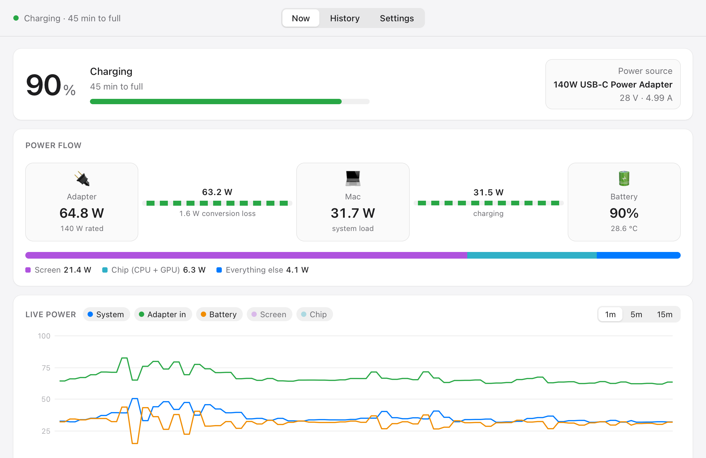

# Pythonflow

A macOS menu bar app that shows where your Mac's power goes: what the charger
delivers, what the Mac uses, and what goes into or out of the battery. It also keeps
a history of every charge.

A Python rewrite of [Powerflow](https://github.com/lzt1008/powerflow), which crashes on
macOS 27 and is no longer maintained.

**[⬇︎ Download the latest version](https://github.com/DigitalN/pythonflow/releases/latest)**
(free, for Macs with Apple silicon)

## Features

- **Menu bar wattage**: system, screen or chip power, or the charger's input while
  charging. Click it for a quick summary.
- **Power flow** from charger to Mac to battery, with the charger's conversion loss and
  where the Mac's power goes.
- **Live chart** of the last 1, 5 or 15 minutes.
- **Battery and charger details**: battery health, cycle count, temperature, voltage and
  current, and the charger's rating and negotiated voltage.
- **Charging history**: each charge's levels, duration and power curve, exportable to CSV.
- A shortcut to macOS's charge limit, in Settings.
- Opens at login, straight to the menu bar, and keeps itself up to date. Both can be
  turned off in Settings.

## Install

1. **Download** `Pythonflow-….dmg` from the
   [latest release](https://github.com/DigitalN/pythonflow/releases/latest) and open it.
2. **Drag Pythonflow into Applications**, as the arrow shows.
3. **Open Pythonflow** from Applications. Its wattage appears in the menu bar; click
   it and choose **Open Dashboard** for the full view.

The first time you open it, macOS may say it can't verify Pythonflow. Click **Done**,
then go to **System Settings → Privacy & Security**, scroll down, and click **Open
Anyway**. You only do this once: Pythonflow isn't distributed through Apple, so Apple
hasn't checked it. All of its code is in this repository.

Tested on macOS 27.0 with Apple silicon. To build from source, see
[DEVELOPMENT.md](docs/DEVELOPMENT.md).

## Privacy

- **The only connection is the update check**: once a day, after your Mac wakes, it asks
  GitHub for the latest release. It only installs updates signed by the same developer.
  No analytics, crash reports or web server.
- **It reads power and temperature sensors only**, never serial numbers or your
  computer's name.
- **Your data stays on your Mac**, in `~/Library/Application Support/Pythonflow`. You can
  turn off history recording or delete it in Settings.

## What the numbers mean

| Reading | What it is |
|---|---|
| **System** | Total power the Mac is using |
| **Adapter in** | Power from the charger into the Mac. The Adapter box adds the charger's conversion loss. |
| **Battery** | Power into the battery (positive) or out of it (negative) |
| **Screen** | Display backlight. On mini-LED screens it rises with bright content. |
| **Chip (CPU + GPU)** | The Apple silicon chip. Apple names the sensor after the heatpipe, but it measures the chip. |
| **Time to full / remaining** | macOS's own estimate, rough above about 80%, where charging slows down. With a charge limit set, the time to the limit instead, since macOS's estimate counts to 100%. |

## Coming from Powerflow

Pythonflow fixes the original's problems on macOS 27: the crash at launch, blank battery
health, "charging" at 100%, "1092 hours" remaining, the menu bar panel that wouldn't open,
and the chart freezing after an upgrade.

On first launch it copies over your charging history and preferences, reading the old
database without changing it. You can then delete `/Applications/powerflow.app`.

## Credits

Based on [Powerflow](https://github.com/lzt1008/powerflow) by The Powerflow Team
(Samuel Lyon / lzt1008). The macOS 27 fixes build on diagnoses from community pull
requests [#19](https://github.com/lzt1008/powerflow/pull/19),
[#21](https://github.com/lzt1008/powerflow/pull/21) and
[#22](https://github.com/lzt1008/powerflow/pull/22).

## License

MIT. See [LICENSE](LICENSE).
